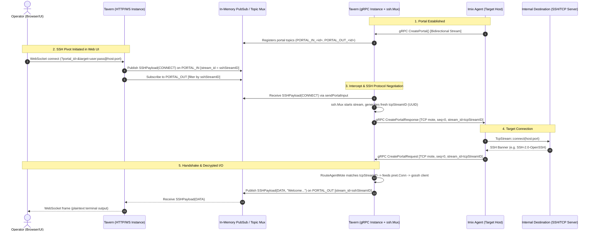

# Working with Portals

> [!IMPORTANT]
> **Self-Updating Contract**: Whenever you make changes to the portal infrastructure (including `tavern/internal/portals/...`, `tavern/internal/c2/api_create_portal.go`, `tavern/portals/...`, or `implants/imix/src/portal/...`), you **MUST** update this document to keep architectural contracts, sequence conventions, stream ID mappings, timeouts, and tests accurate for future agents.

---

## 1. Architectural Overview

Portals provide multiplexed, bi-directional proxying and pivoting capabilities through an agent (e.g. imix) to target internal networks (acting like an authenticated SOCKS5 proxy or protocol-specific pivot).



---

## 2. Core Concepts & Data Structures

### 2.1 The Mote (`portal.proto`)
A **Mote** is an ordered packet in a stream on a portal:
- `stream_id` (string): Identifies the logical stream. Multiple independent streams share the same portal.
- `seq_id` (uint64): Monotonically increasing sequence number starting from 0 for each stream.
- `payload` (oneof):
  - `tcp` (`TCPPayload`): Raw TCP stream chunk (`data`, `dst_addr`, `dst_port`).
  - `udp` (`UDPPayload`): UDP datagram chunk.
  - `bytes` (`BytesPayload`): Control signals (`Close`, `Ping`, `Keepalive`, `Trace`).
  - `ssh` (`SSHPayload`): High-level unencrypted SSH payloads (`Connect`, `Data`, `Resize`, `Close`).
  - `pty_resize`: PTY window dimensions.

### 2.2 PubSub Topics
Each portal uses two primary pubsub topics managed by `tavern/internal/portals/mux/mux.go`:
- `PORTAL_IN_<portal_id>`: Input destined for the agent or the gRPC-side adapter (Tavern WebSocket/CLI -> gRPC Tavern).
- `PORTAL_OUT_<portal_id>`: Output emitted by the agent or gRPC-side adapter (gRPC Tavern -> WebSocket/PubSub subscribers).

### 2.3 Per-Stream Close vs Global Portal Termination
`portalpb.BytesPayloadKind_BYTES_PAYLOAD_KIND_CLOSE` is used for **two distinct purposes**:
1. **Per-Stream EOF**: When a specific TCP or UDP stream ends (e.g. client FIN/EOF), a close mote is sent with `stream_id = <target_stream_uuid>`.
2. **Global Portal Shutdown**: When the entire portal session terminates (e.g. portal closed in Tavern or agent shutting down), a close mote is sent with `stream_id = ""`.

> [!CAUTION]
> **StreamId Check**: Any portal loop monitoring for portal termination (e.g. in `tavern/internal/portals/api_open_portal.go`, `tavern/internal/c2/api_create_portal.go`, `shell/handler.go`) **MUST check `mote.StreamId == ""`** before treating a `CLOSE` mote as portal-wide termination:
> ```go
> if payload := mote.GetBytes(); payload != nil && payload.Kind == portalpb.BytesPayloadKind_BYTES_PAYLOAD_KIND_CLOSE {
>     if mote.StreamId == "" {
>         // Entire portal closed
>         return fmt.Errorf("portal closed")
>     }
> }
> ```
> Missing `mote.StreamId == ""` causes the very first finished TCP stream (e.g. an HTTP request through SOCKS5 closing) to abort the entire portal session.

### 2.4 Application-Layer Crypto & Goroutine ID Inheritance (`cryptocodec`)
gRPC in Realm uses custom application-layer cryptography (`StreamDecryptCodec` in `tavern/internal/cryptocodec/`). Because gRPC's `encoding.CodecV2` interface (`Marshal(v any)`) does not accept a `context.Context` parameter, `cryptocodec` maps client public keys to Goroutines via an internal LRU cache (`session_pub_keys`).

- **Bidirectional Streams (`CreatePortal`)**: During `CreatePortal`, the initial `Recv()` registers the client public key for the main handler goroutine.
- **Child Goroutines**: If child goroutines or asynchronous subsystems (such as `pnet.Dial`, `ssh.Mux`, or internal `golang.org/x/crypto/ssh` worker goroutines) call `gstream.Send` directly, `Marshal` -> `Encrypt` cannot locate the public key because grandchild goroutines are not in `session_pub_keys`. This emits `public key not found for id: 0`, sends unencrypted corrupt frames, and immediately terminates the agent's transport loop.
- **Architecture Requirement**: `CreatePortal` must route all outgoing agent motes through a buffered channel (`agentSendCh`) drained exclusively by the primary `CreatePortal` handler goroutine (registered via `cryptocodec.RegisterCurrentGoroutine(clientPubKey)`). This guarantees both gRPC stream send serialization and seamless cryptographic encryption.

---

## 3. SSH Pivot Architecture (`tavern/internal/portals/ssh/`)

Historically, Tavern negotiated SSH directly on the HTTP WebSocket instance. To improve latency, reliability, and support multi-instance distributed deployments, SSH session negotiation was moved to the **gRPC-receiving Tavern instance**.

### 3.1 Stream ID Decoupling & Sequence Number Isolation
**CRITICAL**: The SSH stream (operator <-> Tavern) and the TCP tunnel stream (Tavern <-> Imix agent) **MUST NOT** share the same `stream_id` or sequence counters!

```text
[Browser WebSocket]
         │  SSHPayload (Plaintext / Terminal I/O)
         │  stream_id: sshStreamID (e.g. "ssh-ws-173000000000")
         │  seq_id: 0, 1, 2, ...
         ▼
[tavern/internal/portals/ssh/mux.go: Mux]
         │  TCPPayload (Encrypted SSH Wire Protocol)
         │  stream_id: tcpStreamID (Fresh UUID v4)
         │  seq_id: 0, 1, 2, ...
         ▼
[implants/imix (Agent) & Remote SSH Server]
```

- **`sshStreamID`**: Generated by the WebSocket handler (`fmt.Sprintf("ssh-ws-%d", time.Now().UnixNano())`). Used exclusively for `SSHPayload` motes over `TopicIn` and `TopicOut`.
- **`tcpStreamID`**: Generated by `Mux.startStream` (`uuid.New().String()`). Passed into `pnet.Dial` and used exclusively for raw TCP motes over gRPC to/from the agent.
- **Why?**:
  1. TCP packet count does **not** map 1:1 with SSH terminal output packets.
  2. Independent sequence numbers prevent sequence collisions in `stream.OrderedReader` and `stream.OrderedWriter`.
  3. Prevents PubSub subscribers from receiving raw encrypted agent TCP packets or premature close signals intended only for the internal `pnet` connection.

### 3.2 Dual Routing in `ssh.Mux`
The `ssh.Mux` struct maintains dual mappings protected by `sync.RWMutex`:
- `sshStreams map[string]*portalSSHStream`: Keyed by `sshStreamID`. Used by `HandleMote` when incoming SSH motes arrive from `PORTAL_IN`.
- `tcpStreams map[string]*portalSSHStream`: Keyed by `tcpStreamID`. Used by `RouteAgentMote` when agent TCP/Close motes arrive from the gRPC stream.
- `pending map[string][]*portalpb.SSHPayload`: Buffers early `DATA` or `RESIZE` motes arriving on `PORTAL_IN` before the `CONNECT` mote has been processed.

```go
// tavern/internal/portals/ssh/mux.go
type Mux struct {
    portalID    int
    mux         *mux.Mux
    sendToAgent AgentSenderFunc

    mu         sync.RWMutex
    sshStreams map[string]*portalSSHStream       // keyed by sshStreamID
    tcpStreams map[string]*portalSSHStream       // keyed by tcpStreamID
    pending    map[string][]*portalpb.SSHPayload // keyed by sshStreamID
    closed     bool
}
```

### 3.3 Interception in `api_create_portal.go`
In `tavern/internal/c2/api_create_portal.go`:
- **Input direction (`sendPortalInput`)**:
  ```go
  if mote.GetSsh() != nil && sshMux != nil {
      sshMux.HandleMote(ctx, mote)
      continue
  }
  // All other motes forwarded directly to agent
  ```
- **Output direction (`sendPortalOutput`)**:
  ```go
  // Intercept agent TCP/Close motes that belong to gRPC-side SSH sessions
  if sshMux != nil && sshMux.RouteAgentMote(mote) {
      continue
  }
  // All other motes published to PORTAL_OUT
  ```

---

## 4. Timeout Hierarchy & Deadlines

A major source of `i/o timeout` during the SSH handshake is deadline mismatch.

| Component | Setting | Value | Purpose |
|---|---|---|---|
| Imix Agent | `tcp::CONNECT_TIMEOUT` | `30s` | Maximum time Tokio waits for `TcpStream::connect` |
| Tavern `ssh.Mux` | `handshakeIdleTimeout` | `45s` | Idle read/write deadline during SSH handshake |
| Imix Agent | `OrderedReader::stale_timeout`| `5s` | Max wait for out-of-order packets before failing |
| Tavern `ssh.Mux` | Keepalive Interval | `15s` | Openssh keepalive ping to target host |

> [!CAUTION]
> **Timeout Rule**: Tavern's `handshakeIdleTimeout` in `mux.go` **MUST be strictly greater** than Imix's `CONNECT_TIMEOUT` (e.g. 45s vs 30s).
>
> If they are equal or Tavern's is smaller, an unreachable host or connection timeout causes Tavern's `net.Conn` deadline to fire first, emitting a misleading `SSH handshake failed: read: i/o timeout`. With `handshakeIdleTimeout = 45s`, the agent's 30s timeout expires first, sending a `Close` mote with `tcp connect timeout: <addr>`, which Tavern cleanly surfaces to the operator.

---

## 5. Agent (`imix`) Handling (`implants/imix/src/portal/`)

### 5.1 Keepalive Filtering
Tavern sends periodic keepalive pings (`BytesPayloadKind::Keepalive`) every 5 seconds to keep the gRPC stream alive.
- In `implants/imix/src/portal/run.rs`, keepalive motes **must be dropped immediately** in the outer loop before stream dispatch:
  ```rust
  if bytes_payload.kind == BytesPayloadKind::Keepalive as i32 {
      continue;
  }
  ```
- Failure to drop them causes Imix to allocate an empty stream for `stream_id = ""` and log sequence warnings.

### 5.2 Outgoing Sequence Generation
Imix uses `PayloadSequencer::new(stream_id)` in `portal-stream`. Each call to `new_tcp_mote` or `new_bytes_mote` increments an atomic `seq_id` starting at `0`. When routing back to Tavern, Tavern's `stream.NewOrderedReader` verifies these sequence IDs.

---

## 6. Development & Testing Checklist

When modifying any portal or SSH pivoting code:

1. **Decouple Stream IDs**: Never pass a WebSocket/operator `stream_id` directly to `pnet.Dial` or agent TCP calls. Always generate a dedicated UUID.
2. **Handle Out-of-Order Packets**: Network transit or pubsub delivery can reorder motes. Maintain buffer queues (`pending`) where necessary.
3. **Format Both Languages**:
   - Go: `go fmt ./tavern/... ./tests/...`
   - Rust: `cargo fmt --all --manifest-path implants/Cargo.toml` (Required by CI!)
4. **Run Unit & Integration Tests**:
   ```bash
   # Go portal SSH tests (covers stream decoupling, timeouts, credential parsing, multi-instance PubSub)
   go test -count=1 -v ./tavern/internal/portals/ssh/...

   # Go C2 stream tests
   go test -v ./tavern/internal/c2/...

   # Full End-to-End Test (Real Imix, Real Tavern, GCP PubSub Emulator, Mock SSH Server)
   go test -v -timeout 120s ./tests/e2e/pivot_ssh_e2e_test.go

   # Rust portal stream and agent tests
   cargo test -p portal-stream --manifest-path implants/Cargo.toml
   cargo test -p imix --manifest-path implants/Cargo.toml
   ```
5. **CI Workflow (`.github/workflows/e2e-pivots.yml`)**:
   - Automated multi-protocol pivot validation pipeline.
   - Builds `tavern`, `imix`, `sshecho`, and `pssh` binaries and runs the E2E test suite under GCP PubSub emulation.
6. **Update This Skill**: If you add new mote kinds, alter the handshake flow, or change timeout values, update this document before concluding your task.
